# Olympic Games Data Analysis: 120 Years of History

**Author:** Ilir Pajo
**Tools:** Google BigQuery (SQL), Looker Studio
**Project type:** Data Analytics Project Proposal (Milestones 1-3)

This project analyzes 120 years of Olympic Games data to understand how participation and performance have changed over time. It looks at the growth in athletes and sports, the rise of female participation, the advantage of host countries, the role of tradition in winning medals, and the link between physical attributes and success.

## Table of contents

1. [Client and dataset](#1-client-and-dataset)
2. [Data cleaning](#2-data-cleaning)
3. [Initial exploration](#3-initial-exploration)
4. [Proposed ERD](#4-proposed-normalized-erd)
5. [Project proposal](#5-project-proposal)
6. [Descriptive statistics](#6-descriptive-statistics)
7. [Hypothesis results](#7-hypothesis-results)
8. [Dive deeper](#8-dive-deeper)
9. [Recommendations and actions](#9-recommendations-and-actions)
10. [Repository structure and how to reproduce](#10-repository-structure-and-how-to-reproduce)

---

## 1. Client and dataset

**Client:** SportsStats is a sports analysis firm partnering with local news and elite personal trainers to provide "interesting" insights to help their partners. Insights can be patterns or trends highlighting certain groups, events, or countries, for the purpose of developing a news story or discovering key health insights.

**Dataset:** Olympics dataset, 120 years of data (Kaggle: *120 years of Olympic history: athletes and results*). It contains two tables.

| Table | Columns |
|---|---|
| `athlete_events.csv` | ID (INTEGER), Name, Sex, Age, Height, Weight, Team, NOC, Games, Year (INTEGER), Season, City, Sport, Event, Medal |
| `noc_regions.csv` | NOC, Region, Notes |

The dataset covers all Summer and Winter Games held during this period, including the athletes who participated, the sports and events they competed in, and the full competition history of each athlete, including whether or not they won a medal.

**Why this dataset.** Analyzing it can help national teams understand why some countries perform better than others. It can also show what could be done to improve both individual and team performance.

The data is **not included** in this repository. Download it from Kaggle (see [How to reproduce](#10-repository-structure-and-how-to-reproduce)).

---

## 2. Data cleaning

1. **Importing the data.** I uploaded the Olympic dataset (CSV file) to BigQuery as a new table, used schema auto-detect, then checked the number of rows, column names, and data types.
2. **Handling missing values.** Missing values were stored as the text `"NA"`, so BigQuery did not read them as NULL. I converted `"NA"` to NULL in Age, Height, Weight, and Medal. Before removing duplicates, the missing values were:
   - Age: 9,474 (3.5%)
   - Height: 60,171 (22%)
   - Weight: 62,875 (23%)

   I kept the missing values in Age, Height, and Weight and excluded them only from the analyses that needed them.
3. **Marking athletes with no medal.** In the Medal column, NULL means the athlete did not win a medal. I replaced these values with `"No Medal"` so that medalists and non-medalists can be compared. After cleaning, 229,959 rows (85%) are marked "No Medal". This is expected and not a data quality issue.
4. **Removing duplicates.** I found 678 groups of records with the same athlete, Games, and event. I removed exact duplicate rows using `SELECT DISTINCT`, which reduced the dataset from 271,116 to 269,731 rows.
5. **Creating a clean view.** I saved the cleaned data as a view (`athlete_events_cleaned`), so the original table stays unchanged. All later analysis uses this view. See [`sql/cleaning_query.sql`](sql/cleaning_query.sql).
6. **Final check.** After cleaning, the missing values were: Age 9,315 (3.0%), Height 58,814 (22%), and Weight 61,527 (23%). The numbers are slightly lower than before because duplicates were removed.

---

## 3. Initial exploration

**Top 10 countries by medals won** (counting medal rows, not "No Medal" rows). Query in [`sql/3_Medals_and_performance.sql`](sql/3_Medals_and_performance.sql):

```sql
SELECT
  noc.Region AS Team,
  COUNTIF(ath.Medal='Gold') AS gold_medals,
  COUNTIF(ath.Medal='Silver') AS Silver_medals,
  COUNTIF(ath.Medal='Bronze') AS Bronze_medals,
  COUNTIF(ath.Medal!='No Medal') AS total
FROM `olympic-games-data-analysis.olympicsAnalysis.athlete_events_cleaned` AS ath
JOIN `olympic-games-data-analysis.olympicsAnalysis.noc_regions` AS noc ON ath.NOC=noc.NOC
GROUP BY Team
ORDER BY total DESC
LIMIT 10;
```

**Editions with the highest and lowest participation.** To measure participation over time, I counted the unique athletes (by ID) in each Games, separated by Summer and Winter.

```sql
WITH participants_per_year AS (
  SELECT Year, Season, COUNT(DISTINCT ID) AS nr_of_participants
  FROM `olympic-games-data-analysis.olympicsAnalysis.athlete_events_cleaned`
  GROUP BY Year, Season
)
(SELECT 'Highest' AS type, Year, Season, nr_of_participants
 FROM participants_per_year ORDER BY nr_of_participants DESC LIMIT 1)
UNION ALL
(SELECT 'Lowest' AS type, Year, Season, nr_of_participants
 FROM participants_per_year ORDER BY nr_of_participants ASC LIMIT 1);
```

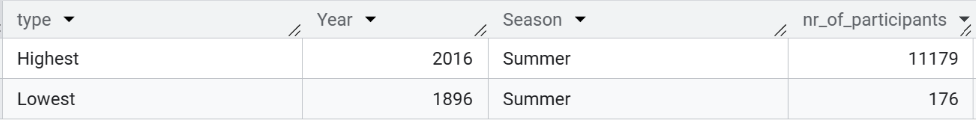

**Most decorated athlete.**

```sql
WITH decorated_athlet AS (
  SELECT *
  FROM `olympic-games-data-analysis.olympicsAnalysis.athlete_events_cleaned`
  WHERE Medal != "No Medal"
),
most_decorated_athlets AS (
  SELECT Name, COUNT(Medal) AS nr_of_medals
  FROM decorated_athlet
  GROUP BY Name
  ORDER BY nr_of_medals DESC
  LIMIT 1
)
SELECT
  d.Name, d.Year, d.Season,
  COUNTIF(d.Medal = 'Gold') AS gold_medals,
  COUNTIF(d.Medal = 'Silver') AS Silver_medals,
  COUNTIF(d.Medal = 'Bronze') AS Bronze_medals,
  COUNT(Medal) AS total
FROM decorated_athlet AS d
JOIN most_decorated_athlets AS md ON d.Name = md.Name
GROUP BY d.Name, d.Year, d.Season
ORDER BY d.Name, d.Year, d.Season;
```

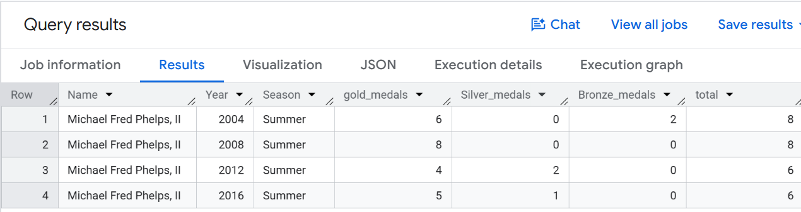

---

## 4. Proposed normalized ERD

The original dataset is denormalized, with one table (`athlete_events_cleaned`). Below is a proposed normalized ERD that separates it into related tables. The central table, **Participations**, links Athletes, Countries, Games, and Events. Sports are linked to Events. Age, Height, Weight, and Medal stay in Participations because they change from one Games to another.

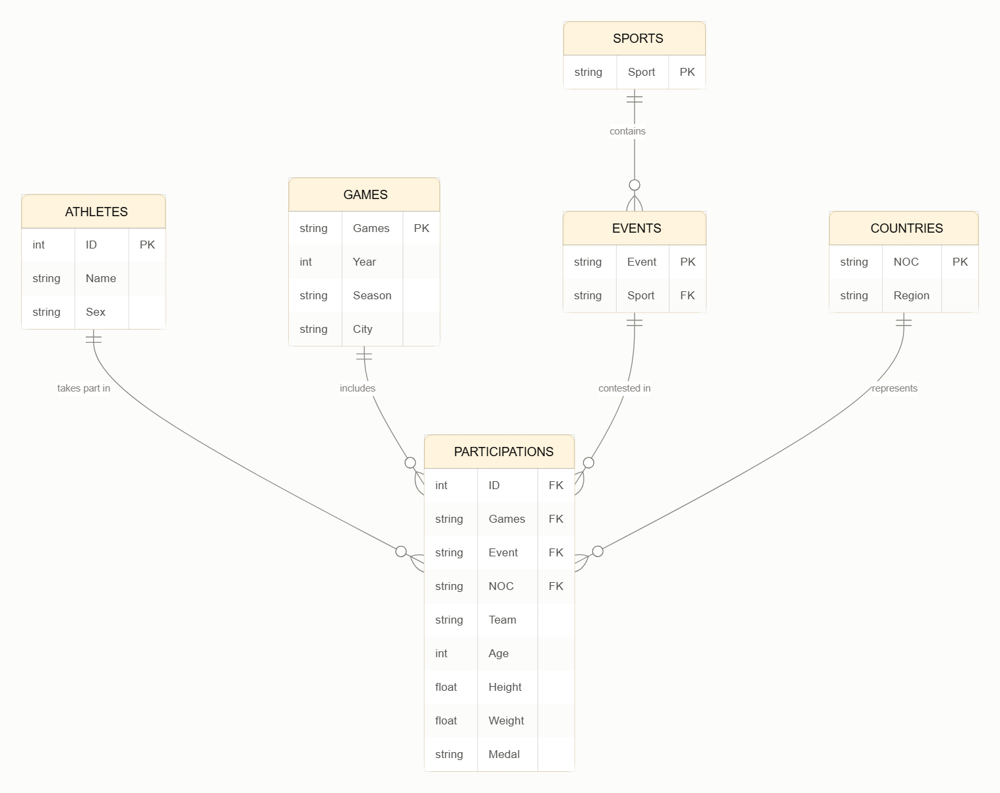

---

## 5. Project proposal

### Project description

This project analyzes 120 years of Olympic Games data to understand how participation and performance have changed over time. The data was cleaned and analyzed in BigQuery using SQL, and the main trends are shown through simple charts. The findings could help national teams and coaches understand why some countries perform better and how to improve both individual and team results. They may also interest sports federations, Olympic committees, and sports analysts who plan programs and investments. Finally, sports fans, students, and journalists can use the results to better understand the history of the Games.

### Questions to ask

**Participation and growth**
- How has the number of participating athletes changed over the 120 years?
- Which Games had the highest and lowest participation, and why (e.g., boycotts, wars)?
- How has the number of sports and events expanded over time?

**Gender representation**
- How has the ratio of male to female athletes changed over time?
- When did women's participation begin in each sport?
- Is the gender gap closing in both Summer and Winter Games?

**Medals and performance**
- Which athletes are the most decorated in Olympic history?
- What percentage of participants actually win a medal?
- Do host countries perform better when hosting than in other years?
- Which countries dominate specific sports?

### Initial hypotheses

- **H1: Growth in participation.** The number of athletes at the Games has increased since 1960, and this growth is positively correlated with the increase in the number of sports and events offered in each edition.
- **H2: Female participation.** The number and proportion of female athletes has increased over time, with the share of women growing in most editions since 1900 and approaching parity with men in recent Games.
- **H3: Tradition and medals.** Countries with a long history of winning medals in a specific sport (e.g., medals in at least 5 previous editions) are more likely to win medals in that sport again than countries with no prior medal history.
- **H4: Host country advantage.** Host countries win significantly more medals in the year they host the Games than in the editions immediately before and after.
- **H5: Physical attributes and success.** Medalists in sports such as basketball and swimming are taller on average than non-medalists in the same sport.

### Data analysis approach

1. **Data understanding and cleaning.** Inspect the structure of the dataset, handle missing values, replace missing Medal values with "No Medal", and check for duplicates and inconsistencies in NOC codes.
2. **Exploratory data analysis (EDA).** Analyze the distribution of key variables (age, height, weight) overall and by sport; count athletes, countries, sports, and events per edition; visualize trends over time.
3. **Hypothesis testing by analysis.** Test each hypothesis with SQL (see [section 7](#7-hypothesis-results)).
4. **Interpretation and limitations.** Compare the results with the initial hypotheses and state whether each is supported or rejected. Note limitations: missing data, changes in country borders and NOC codes, team events counting multiple medals for one result, and external factors not in the dataset (population, budget).

---

## 6. Descriptive statistics

The queries for this section are in [`sql/1_Participation_and_growth.sql`](sql/1_Participation_and_growth.sql), [`sql/2_Gender_representation.sql`](sql/2_Gender_representation.sql), and [`sql/3_Medals_and_performance.sql`](sql/3_Medals_and_performance.sql).

| Statistic | What I looked at | Why |
|---|---|---|
| Row counts and duplicates | Size of the data before and after removing duplicates | So repeated rows do not inflate athlete and medal counts (271,116 to 269,731 rows) |
| Missing values (count and %) | Age, Height, Weight, Medal | To know which columns can be trusted (Age 3%, Height 22%, Weight 23%) |
| Share of "No Medal" | Percentage of records without a medal | About 85% of records have no medal |
| Unique athletes, events, and sports per Games | Size of each edition | To see how the program grew (H1) |
| Change and % change | Difference from the previous edition | Growth over time, and where numbers drop |
| Correlation | Athletes vs. events and sports | To test whether they move together (H1) |
| Female-to-male ratio and % women | Gender balance per Games | Shows balance better than raw counts (H2) |
| Medal counts per athlete | Gold, silver, bronze, and total medals | To find the most decorated athletes |

**Missing values**

```sql
SELECT
  COUNTIF(Age = 'NA') AS missing_age,
  ROUND((COUNTIF(Age = 'NA') / COUNT(*)) * 100, 1) AS percentage_of_missing_age,
  COUNTIF(Height = 'NA') AS missing_height,
  ROUND((COUNTIF(Height = 'NA') / COUNT(*)) * 100, 1) AS percentage_of_missing_height,
  COUNTIF(Weight = 'NA') AS missing_weight,
  ROUND((COUNTIF(Weight = 'NA') / COUNT(*)) * 100, 1) AS percentage_of_missing_weight,
  COUNTIF(Medal = 'NA') AS no_medal,
  ROUND((COUNTIF(Medal = 'NA') / COUNT(*)) * 100, 1) AS percentage_of_missing_medal
FROM `olympic-games-data-analysis.olympicsAnalysis.athlete_events`;
```

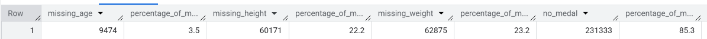

**Change and % change in the number of events**

```sql
WITH growth_in_events AS (
  SELECT Season, Year, COUNT(DISTINCT Event) AS number_of_events
  FROM `olympic-games-data-analysis.olympicsAnalysis.athlete_events_cleaned`
  GROUP BY Season, Year
)
SELECT
  Season, Year, number_of_events,
  LAG(number_of_events) OVER w AS previous_nr_of_events,
  number_of_events - LAG(number_of_events) OVER w AS change,
  ROUND(SAFE_DIVIDE(number_of_events - LAG(number_of_events) OVER w,
                    LAG(number_of_events) OVER w) * 100, 1) AS prc_change
FROM growth_in_events
WINDOW w AS (PARTITION BY Season ORDER BY Year)
ORDER BY Season, Year;
```

**Correlation (athletes vs. events and sports, 1960 onwards)**

```sql
WITH per_edition AS (
  SELECT
    Season, Year,
    COUNT(DISTINCT ID) AS athletes,
    COUNT(DISTINCT Event) AS events,
    COUNT(DISTINCT Sport) AS sports
  FROM `olympic-games-data-analysis.olympicsAnalysis.athlete_events_cleaned`
  WHERE Year >= 1960
  GROUP BY Season, Year
)
SELECT
  Season,
  ROUND(CORR(athletes, events), 2) AS corr_athletes_events,
  ROUND(CORR(athletes, sports), 2) AS corr_athletes_sports
FROM per_edition
GROUP BY Season;
```

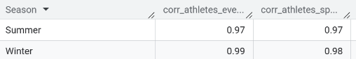

**Female-to-male ratio per Games** (female athletes per male athlete)

```sql
SELECT
  Season, Year,
  ROUND(SAFE_DIVIDE(COUNTIF(Sex='F'), COUNTIF(Sex='M')), 2) AS ratio
FROM `olympic-games-data-analysis.olympicsAnalysis.athlete_events_cleaned`
GROUP BY Season, Year
ORDER BY Season, Year;
```

**Top 10 most decorated athletes**

```sql
SELECT
  ath.Name, noc.region, ath.Sex,
  COUNTIF(ath.Medal = 'Gold') AS gold_medals,
  COUNTIF(ath.Medal = 'Silver') AS Silver_medals,
  COUNTIF(ath.Medal = 'Bronze') AS Bronze_medals,
  COUNTIF(ath.Medal != 'No Medal') AS total
FROM `olympic-games-data-analysis.olympicsAnalysis.athlete_events_cleaned` AS ath
JOIN `olympic-games-data-analysis.olympicsAnalysis.noc_regions` AS noc ON ath.NOC = noc.NOC
WHERE ath.Medal != 'No Medal'
GROUP BY ath.Name, noc.region, ath.Sex
ORDER BY total DESC, gold_medals DESC, Silver_medals DESC, bronze_medals DESC
LIMIT 10;
```

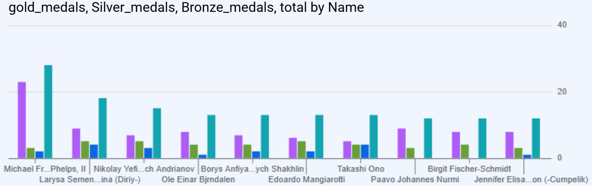
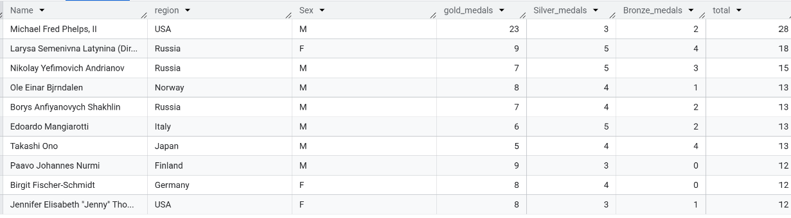

---

## 7. Hypothesis results

| Hypothesis | Verdict |
|---|---|
| H1: Growth in participation | Supported |
| H2: Female participation | Supported, with limits |
| H3: Tradition and medals | Supported |
| H4: Host country advantage | Supported |
| H5: Physical attributes and success | Partly supported |

### H1: supported

Athletes are strongly correlated with the number of events and sports since 1960 (Summer 0.97 and 0.97, Winter 0.99 and 0.98). A limit is that correlation does not prove cause, since both grew over time, and there are only 15 editions per season.

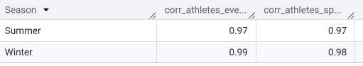

### H2: supported, with limits

The share of women increased in most editions, but not in all, and parity has not been reached. The ratio shown below is female athletes per male athlete (0.83 means 83 women for every 100 men). Women were under 2% of Summer athletes in 1900 and about 45% in 2016, and about 3.7% of Winter athletes in 1924 and about 41% in 2014.

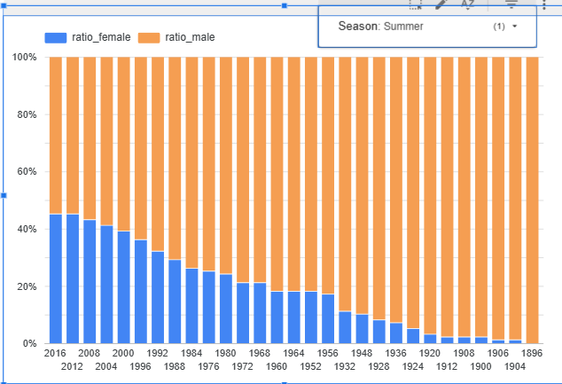
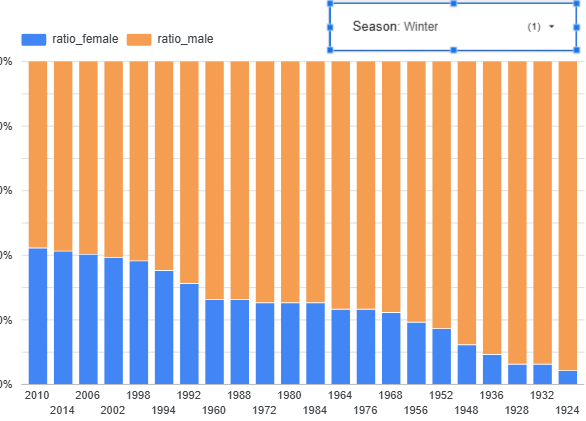

### H3: supported

Countries with 5 or more previous medal editions in a sport won a medal in 63.9% of cases, compared with 40.8% for countries with 1-4 prior medal editions and 7.3% for countries that had entered the sport before without winning. Countries entering a sport for the first time won in 14.6% of cases, which is higher than the previous group, probably because strong countries often join newly added sports. Medals were counted once per country, sport, and edition, so team sports are not inflated. The result shows that tradition is strongly linked to winning, but it does not prove it is the cause: larger and richer countries tend to have both a long history and more athletes, and the dataset has no population or budget data.

Query: [`sql/H3_Tested.sql`](sql/H3_Tested.sql)

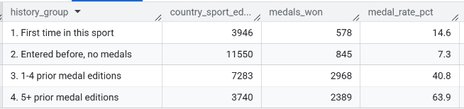

### H4: supported

Host countries won more medals in their hosting year than in the previous edition in 44 of 48 cases (92%), and had their highest total of the three editions in 36 of 46 comparable cases (78%). The typical gain was 17 medals at the Summer Games and 3 at the Winter Games. Medals were counted once per country, event, and edition. Ten hosts were exceptions, such as France in 1924 and the USA in 1996. Percentage changes are not reliable for countries with very few earlier medals, so absolute changes and medians were used. The 1980 and 1984 boycotts probably inflated the results of the USSR and the USA. The data does not show why hosts win more.

Queries: [`sql/Creating_Table_host_Countries.sql`](sql/Creating_Table_host_Countries.sql) and [`sql/H4_Host_country_advantage.sql`](sql/H4_Host_country_advantage.sql). The dataset only has the host city, so a small lookup table with the host country (NOC code) of each Games was created.

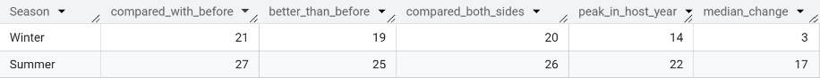
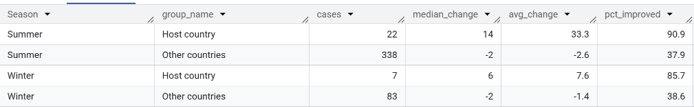

### H5: partly supported

Medalists were taller than non-medalists in basketball and swimming, for both men and women. The differences were about 3 cm in swimming (men and women), 3.6 cm in men's basketball, and only 0.8 cm in women's basketball, which is practically negligible. Each athlete was counted once per Games and sport, and men and women were compared separately. Height is missing for about 22% of athletes, mostly in early Games, and team members are all counted as medalists, so the result describes athletes with data. The data does not show whether height causes success or whether stronger programs simply select taller athletes.

Query: [`sql/H5_Physical_attributes_and_success_.sql`](sql/H5_Physical_attributes_and_success_.sql)

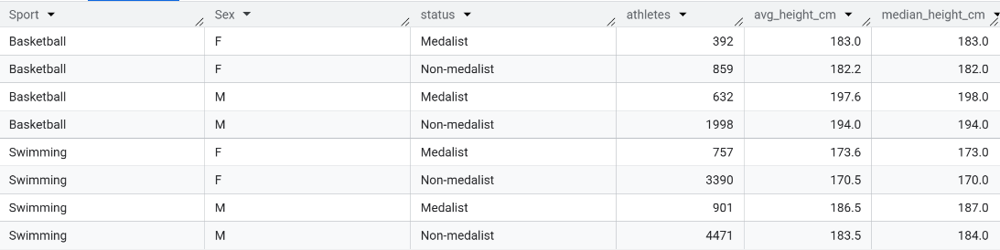

---

## 8. Dive deeper

### Correlation 1: athletes vs. events and sports (Pearson, 1960 onwards)

The correlation is almost perfect in both seasons, which means editions with a bigger program have clearly more athletes. This does not prove that new events cause more athletes, because both grew over time. With 15 editions per season, the values are indicators, not proof.

### Linear regression (athletes on events, 15 editions per season since 1960)

The relationship is strongly linear. Each additional event is associated with about 41 more athletes at the Summer Games and about 29 more at the Winter Games. The intercepts have no practical meaning, since no Games had zero events. The model should only be used within the range observed, because Summer events have been almost flat since 2000 (300 in 2000, 306 in 2016).

Query: [`sql/4_Linear_Regresion_.sql`](sql/4_Linear_Regresion_.sql)

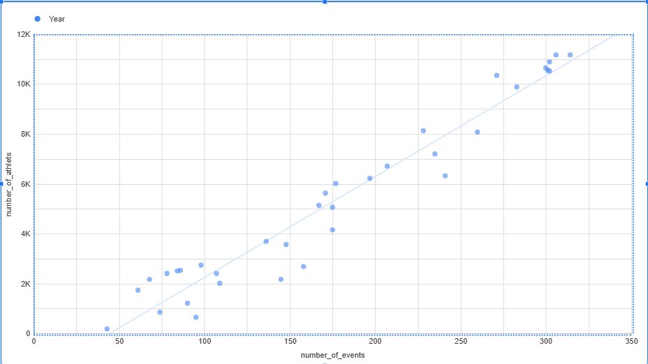

### Correlation 2: height vs. winning a medal (same sport and sex)

Medalists are taller than non-medalists in all four groups, and the difference is positive both before and after 1980, so changes over time do not explain it. It is clear in swimming and men's basketball, but not reliable in women's basketball (t = 1.4 from 1980 onwards). The data cannot show whether height causes success or whether stronger programs select taller athletes.

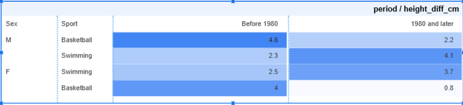

### Go broader: what jumps out

- **The Summer program stopped growing after 2000** (300 events in 2000, 306 in 2016), while Winter kept growing (46 events in 1988, 98 in 2014).
- **Tradition matters a lot.** Countries with 5 or more previous medal editions in a sport won a medal in 63.9% of cases, compared with 7.3% for countries that had entered the sport before without medals.
- **Hosts gain a lot.** At the Summer Games, hosts gained a median of 14 medals over the previous edition while other countries lost 2, and 90.9% of hosts improved against 37.9% of other countries.
- **Small sports are more dominated.** Luge has the highest concentration (Germany, 58.1%), while large sports such as wrestling and boxing have leaders with only 12-15%.
- **How countries are counted matters.** Merging the USSR, Unified Team, and Russia, and the two Germanys, changed the leading country in five sports.

### Text analysis

I did not do text analysis or TF-IDF, because the dataset is mostly numeric and categorical. Instead, I looked at counts, ratios, percentage changes, correlations, differences in averages, rankings by edition, sport, and country, and comparisons between groups. The Event column contains text (for example "Men's" and "Women's"), which could be used in a simple word count to compare men's and women's events.

### New metrics

**Metric 1: medal rate by tradition group.** `medal_rate_pct` = country-sport-editions with a medal ÷ all country-sport-editions in the group. It showed a rate of 7.3% for countries that entered a sport without medals, 14.6% for first-time entries, 40.8% for countries with 1-4 prior medal editions, and 63.9% for 5 or more. Medals are counted once per country, sport, and edition, so team sports do not inflate the numbers.

**Metric 2: leading country's share of medals.** `share_pct` = a country's medals in a sport ÷ all medals in that sport. Raw medal counts cannot be compared between large sports (athletics, 2,939 medals) and small ones (luge, 129). The share puts dominance on one scale, from 58.1% in luge to 11.7% in sailing.

---

## 9. Recommendations and actions

### Recommendations

1. **Build long-term programs in a few sports instead of spreading resources thin.** Countries with 5 or more previous medal editions in a sport won a medal in 63.9% of cases, compared with 7.3% for countries that had entered the sport before without winning. Steady investment in selected sports looks more effective than short-term efforts across many.
2. **Newer programs should consider sports where medals are spread across many countries.** In large sports such as wrestling (15.0%), boxing (12.0%), and sailing (11.7%), the leading country holds only a small share of medals. In small sports such as luge (58.1%, Germany) or badminton (38.1%, China), a few countries dominate, so breaking in is harder.
3. **Host countries should prepare for a large gain, and plan for the edition after.** At the Summer Games, hosts gained a median of 14 medals over the previous edition, while other countries lost 2. The gain is not guaranteed (France in 1924, USA in 1996), and in many cases medals dropped in the next edition (for example Greece, from 16 to 4 in 2008), so hosts should plan to keep investing afterwards.
4. **Use height as one factor in talent selection, not the only one.** Medalists were about 3 cm taller in swimming (men and women) and 3.6 cm taller in men's basketball. In women's basketball, the difference was too small to be reliable (0.8 cm).
5. **Federations should keep supporting women's participation.** Women made up about 45% of Summer athletes in 2016 and about 41% of Winter athletes in 2014. Parity has not been reached, and the share dropped in some editions (for example Summer 1936 and Winter 1964).
6. **Plan athlete numbers around the number of events.** Athletes and events are strongly linked (R² = 0.93 Summer, 0.98 Winter), with about 41 more athletes per new event in the Summer Games. Summer events have been almost flat since 2000, so large growth in participation should not be expected without new events.

### Actions

| Who | Action | Based on |
|---|---|---|
| National teams | Pick 2-3 priority sports and fund them for several Games in a row | H3: tradition (63.9% vs 7.3%) |
| National teams | Compare the competition in each sport using the leader's share before choosing where to invest | Share of medals by sport |
| Host organizers | Enter a full team in every sport, and prepare a post-Games investment plan | H4: median +14 medals (Summer) |
| Coaches and scouts | Add height benchmarks by sport and sex to talent identification, next to technical tests | H5: swimming and men's basketball |
| Sports federations | Keep adding women's events and development programs, and track the share of women every cycle | H2: 45% (Summer 2016), 41% (Winter 2014) |
| Olympic committees | Use the events-to-athletes relationship when planning venues, housing, and budgets | H1: R² = 0.93 and 0.98 |

### Limitations

These recommendations are based on associations in historical data, not proven causes. Larger and richer countries tend to have both a long tradition and more athletes, and the dataset has no population or budget data. Height is missing for about 22% of athletes, mostly in early Games. Country codes for the USSR, Germany, and the Unified Team are merged in some results, which changes the leader in five sports.

### Next steps for the analysis

- Add population, GDP, or sports budget data to separate tradition from country size.
- Repeat the host test by decade and for countries that hosted the Winter Games.
- Analyze BMI by sport and sex, to see where body mass matters beyond height.
- Compare women's events with women athletes by sport.

---

## 10. Repository structure and how to reproduce

```
.
├── README.md
├── sql/
│   ├── cleaning_query.sql
│   ├── Creating_Table_host_Countries.sql
│   ├── 1_Participation_and_growth.sql
│   ├── 2_Gender_representation.sql
│   ├── 3_Medals_and_performance.sql
│   ├── 4_Linear_Regresion_.sql
│   ├── H3_Tested.sql
│   ├── H4_Host_country_advantage.sql
│   └── H5_Physical_attributes_and_success_.sql
└── images/        (charts and query results used in this README)
```

**To reproduce the analysis:**

1. Download `athlete_events.csv` and `noc_regions.csv` from Kaggle ("120 years of Olympic history: athletes and results").
2. Upload both files to BigQuery as tables named `athlete_events` and `noc_regions` (schema auto-detect).
3. Replace `olympic-games-data-analysis.olympicsAnalysis` in the queries with your own project and dataset.
4. Run `sql/cleaning_query.sql` first (it creates the cleaned view), then `sql/Creating_Table_host_Countries.sql` (needed for H4), then the other queries.

**Notes for BigQuery Sandbox users:** the free tier does not allow `INSERT`, `UPDATE`, or `DELETE`, which is why the host lookup table is created with `CREATE TABLE ... AS SELECT`.
